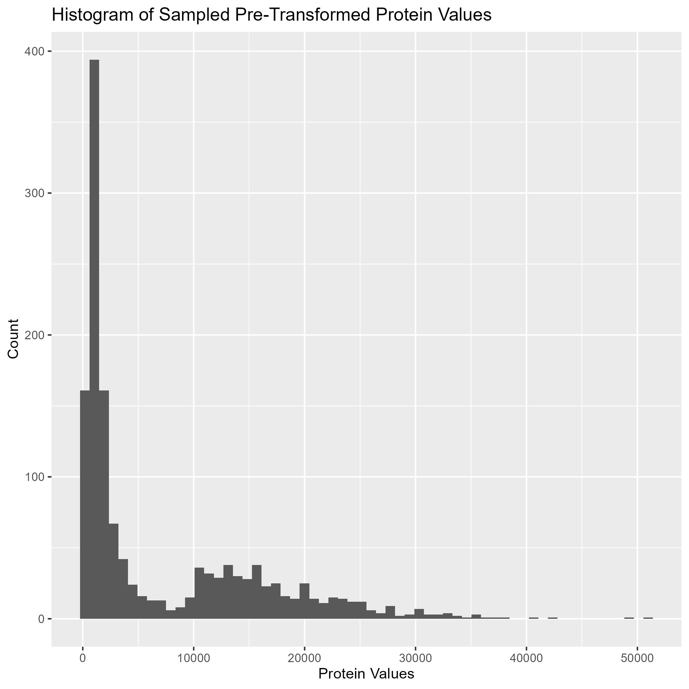
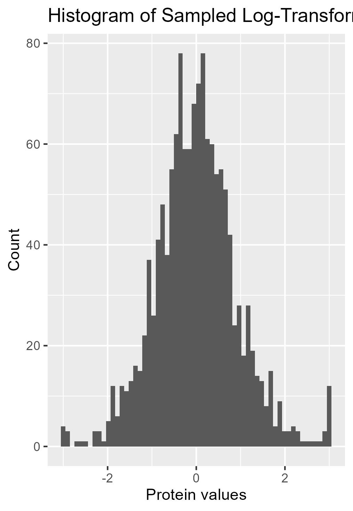
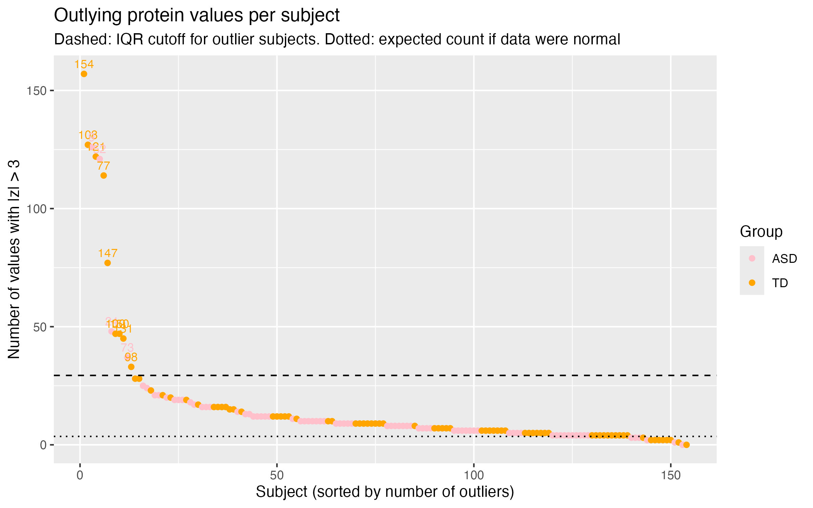
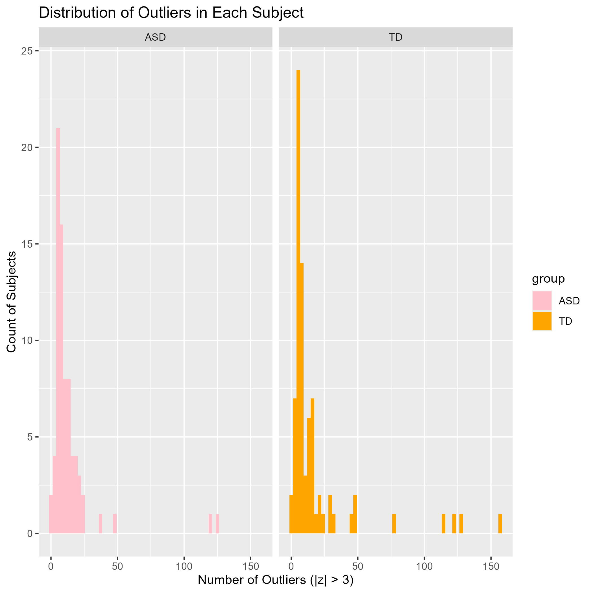

```{r}
# load any other packages and read data here
library(tidyverse)
library(knitr)
```

## Abstract

In this reproduced analysis, we utilized the existing database of serum data from Hewitson et al. (2001) which proposed a panel proteins that were meant to distinguish boys with autism spectrum disorder (ASD) and those that were typically developing (TD). The data consisted of 154 subjects and 1,317 proteins. We reproduced a simplified workflow of the published analysis, and made multiple modifications in the methodology to examine the sensitivity the accuracy classification as we made those changes. We noted that the log-transformation applied to the data centered the raw protein values to zero, which were heavily right-skewed. Subjects with their number of outliers were compared to each other by group, and found that there were a handful that were outliers from their group, but there was not a large enough number of subjects to skew one group or another. Modifications to the methodology which included training models with a training partition of the data, choosing a higher selection of predictive proteins, and using a fuzzy intersection rather than a hard intersection, yielded a lower AUROC score compared to the original simplified analysis. Combinations of methods were attempted to find a better accuracy classification score, and discovered that a combination of using training partitioned data for the selection procedure, and fuzzy intersection led to a similar panel of 5 proteins which had the same classification accuracy (0.8387097). Without the split data and with a hard intersection, a panel of 7 proteins were created with a very optimistic classification accuracy (0.9354839).

## Dataset

The data came from Hewitson et al. (2021), who collected serum samples from 154 boys aged 18 months to 8 years: 76 diagnosed with autism spectrum disorder (ASD) and 78 typically developing (TD) boys. Protein levels in each sample were measured with SomaLogic's SOMAScan 1.3K assay, which gave 1,317 proteins per subject. The data also includes each subject's group (ASD or TD) and for the ASD group, an ADOS score measuring symptom severity. The published analysis used 1,125 of the proteins after excluding 192, but our analysis keeps all 1,317.

To preprocess the data, we log10-transformed each protein's raw levels, which are heavily right-skewed, and then centered and scaled each protein to z-scores. In the original pipeline, any z-score beyond +/- 3 was trimmed to +/- 3 to limit the influence of extreme values. For Q2, we also made an untrimmed version of the data so we could look at those outlying values directly.

## Summary of published analysis

Summarize the methodology of the paper in 1-3 paragraphs. You need not explain the methods in depth as we did in class; just indicate what methods were used and how they were combined. If possible, include a diagram that depicts the methodological design. (Quarto has support for [GraphViz and Mermaid flowcharts](https://quarto.org/docs/authoring/diagrams.html).) Provide key results: the proteins selected for the classifier and the estimated accuracy.

## Findings

### Impact of preprocessing and outliers

To look at outliers, we removed the trimming step from preprocessing and counted how many of each subject's 1,317 protein values fell beyond \|z\| \> 3. If the log-transformed levels were normally distributed, we'd expect about 3.6 such values per subject, but the median was 8.5, so the data has heavier tails than normal across the board. Below is a histogram depicting the pre-transformed data as well as a histogram depicting the log transformed protein values for reference.

{fig-align="center" width="360"}

{fig-align="center" width="360"}

Some subjects stood far apart from the rest, though: using an IQR rule on the per-subject counts (cutoff was approx. 29), we flagged 13 outlier subjects, and six of them had between 114 and 157 outlying values each. For several of these subjects, nearly all of the outlying values were in the same direction (subject 9, for example, had 126 unusually high values and none unusually low), which looks more like the whole sample running high, possibly from sample handling or concentration, than a few individual proteins behaving strangely.

{width="1800"}

Outlier subjects were somewhat more common in the TD group (9 of 78) than in the ASD group (4 of 76), but the difference wasn't statistically significant (Fisher's test, p approx. 0.25), and the number of outlying values per subject didn't differ between groups either (Wilcoxon rank-sum test, p approx. 0.82). Within the ASD group, outlier counts were also unrelated to the ADOS score (Spearman's p approx. -0.04, p approx. 0.72). Overall, a handful of subjects are clear outliers, but they aren't concentrated in one group enough to suggest they're driving the differences between ASD and TD.

{fig-align="center" width="1800"}

### Methodological variations

To see how the model could be improved, we experimented with several adjustments and compared the results of several variations of the model to find what worked best. The first adjustment to the model we made was to partition the data into a training and test data set before any processing. In the original model, this step was made after the optimal set of proteins was selected, meaning that the test sample influenced this decision. Moving this step to the start and basing all calculations and decisions solely on the training data set ensures that this does not happen. While this resulted in a decrease in the model's accuracy, specificity, sensitivity, and ROC AUC, doing this prevents the protein selection to be biased to include the data in the test data sets and ensures the resulting metric are not overly optimistic.

We also adjusted the number of proteins chosen for analysis. The proteins were selected through two separate methods in the original model, and later combined using the intersection of both selections. For our new model, we tested different combinations of the number of proteins being selected from each model, like 5 proteins chosen by the t-tests and 15 proteins chosen by the random forest for example. The minimum number of proteins selected by each method was 5 and the maximum number selected was 40. The resulting amount of proteins, after taking either the intersection or union from the two selection methods, each model used ranges from 3 to 60. On top of that, each combination of proteins was tested with both with a hard intersection, like the original model where only proteins from both selections are used, and a fuzzy intersection, which uses all the proteins selected. Some graphical results of this experimentation are shown below.

```{r}
finalResults <- read.csv('../data/Q3v2_results.csv')
finalResults_rearange <- finalResults %>%
  group_by(proteins_s1,	proteins_s2, intersection) %>%
  mutate(group_auc = .estimate[.metric == 'roc_auc']) %>%
  ungroup() %>%
  arrange(desc(group_auc), proteins_s1,	proteins_s2, intersection)
kable(head(finalResults_rearange[,c(2,4,5,6,7,8)], n = 20), 
      col.names = c('Metric', 
                    'Estimte', 
                    'Proteins T-test', 
                    'Proteins Random Forest', 
                    'Total Proteins', 
                    'Intersection Type'),
      caption = 'Metrics for Some Higher Performing Models Sorted by AUC')
plot(finalResults[finalResults$intersection != 'Fuzzy' &  finalResults$.metric == 'roc_auc',]$.estimate ~ finalResults[finalResults$intersection != 'Fuzzy' &  finalResults$.metric == 'roc_auc',]$total_proteins,
     main = 'Comparing AUC Values to Protein Count for Hard Intersection', ylab = 'AUC', xlab = 'Protein Count')

plot(finalResults[finalResults$intersection != 'Hard' &  finalResults$.metric == 'roc_auc',]$.estimate ~ finalResults[finalResults$intersection != 'Hard' &  finalResults$.metric == 'roc_auc',]$total_proteins,
     main = 'Comparing AUC Values to Protein Count for Fuzzy Intersection', ylab = 'AUC', xlab = 'Protein Count')

#Shows that Fuzzy intersection on average performs worse in general
boxplot(finalResults[finalResults$.metric == 'roc_auc',]$.estimate ~ finalResults[finalResults$.metric == 'roc_auc',]$intersection,
        main = 'Comparing AUC Values to Intersection Type', ylab = 'AUC', xlab = 'Intersection Types')
```

Through testing out several models, we found that excessive amounts of proteins ended up hurting the model overall. The same effect seemed to occur when there were too few proteins. The models that performed the best overall were somewhere in between with around 10 for the hard intersection models and 20 to 30 for fuzzy intersection models. On average, models with hard intersections outperformed those with fuzzy intersections for all metrics (accuracy, specificity, sensitivity, and ROC AUC) as seen in the scatter plots and box plots. However, the highest performing models were ones with fuzzy intersections, as seen in the data table. The best models performed with a ROC AUC value of over 0.85, and had similarly high specificity values, usually over 0.80. The accuracy rates and sensitivity rates generally are slightly lower, usually being around 0.80 and 0.70 respectively. Below is a table assessing models based on accuracy score.

```{r}
finalResults <- read.csv('../data/Q3v2_results.csv')
finalResults_rearange <- finalResults %>%
  group_by(proteins_s1,	proteins_s2, intersection) %>%
  mutate(group_auc = .estimate[.metric == 'accuracy']) %>%
  ungroup() %>%
  arrange(desc(group_auc), proteins_s1,	proteins_s2, intersection)
kable(head(finalResults_rearange[,c(2,4,5,6,7,8)], n = 20), 
      col.names = c('Metric', 
                    'Estimte', 
                    'Proteins T-test', 
                    'Proteins Random Forest', 
                    'Total Proteins', 
                    'Intersection Type'),
      caption = 'Metrics for Some Higher Performing Models Sorted by Accuracy')
```

The scatter plots and box plots for accuracy (not shown) depict a similar trend where, on average, models using a hard intersection over a fuzzy intersection perform better. In this case though all the best performing models are using a hard intersection. The models that perform better in terms of accuracy show high values for all metrics.

### Improved classifier

With the combinations of split data, fuzzy intersection, and a selection of 10 predictive proteins, our classifier could only achieve a panel of 5 proteins with the same accuracy score as the original analysis which was 0.8387097. The 5 main proteins within the panel were DERM, RELT, MRC2, IgD, and Cadherin-5. Without split data and with a hard intersection, the next best accuracy score achieved was 0.9354839 with a panel of 7 proteins, which is significantly higher than the original. The 7 main proteins were again DERM, RELT, MRC2, IgD, PTN, Cadherin-5, and Notch 1. However, as established in examining the methodological variations, models without the split data provided highly optimistic accuracy scores which should warrant suspicion of the improvement. Therefore, the best panel achieved from splitting data and using a fuzzy intersection. We could not simplify further from 5 proteins and achieve a better accuracy score than the original model.
