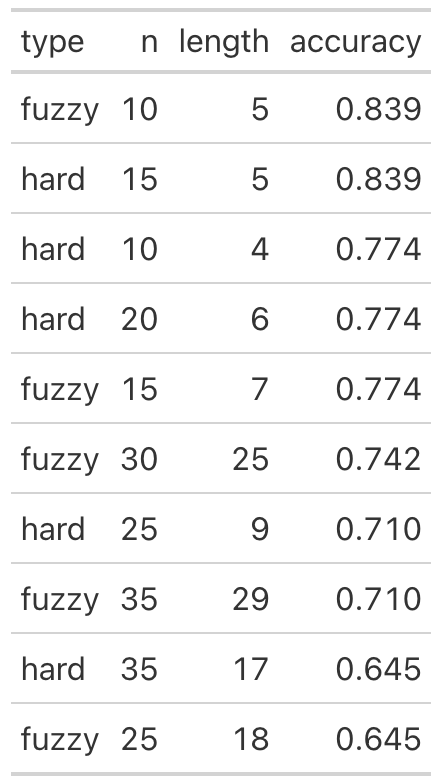
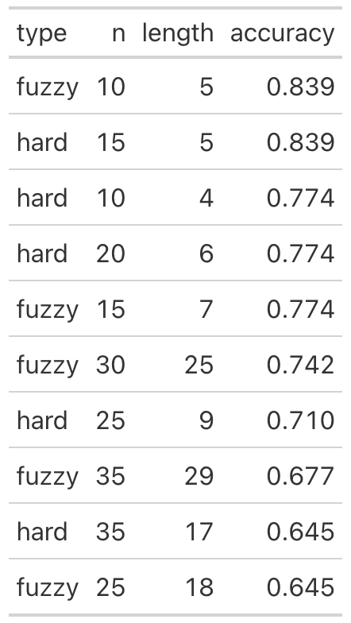

```{r}
# load any other packages and read data here
library(tidyverse)
library(knitr)
```


## Summary of published analysis

Summarize the methodology of the paper in 1-3 paragraphs. You need not explain the methods in depth as we did in class; just indicate what methods were used and how they were combined. If possible, include a diagram that depicts the methodological design. (Quarto has support for [GraphViz and Mermaid flowcharts](https://quarto.org/docs/authoring/diagrams.html).) Provide key results: the proteins selected for the classifier and the estimated accuracy.


In order to identify which proteins' serum levels indicated the presence of ASD, Hewitson et al. utilized various methods, including random forest, multiple testing involving t-tests, correlation-based methods. The 10 proteins with the best respective metrics were selected from these three methods to train a logistic regression model. Random Forest involved creating bootstrap samples for each tree, then picking a random subset of predictors at each split, and combining predictions across different trees. MeanDecreaseGini (mean decrease in Gini Index) was used to measure a protein's importance to predict ASD versus TD. The RF model was trained 100 times using normalized data, then each protein's importance value was averaged over the 100 runs. Then, the RF-based prediction model picked the 10 proteins with highest average importance values. Multiple testing involved using t-test to identify if there was a significant difference in serum levels between different groups for a protein. Then, the proteins whose t-test indicated a significant difference were formed together in a panel. 1,317 different t-tests are carried out, and in principle, it is a conceptually simple task. However, familywise error rate rises when multiple tests are conducted, leading to higher rates of a Type I error (false positive). Bonferroni correction is implemented to handle this issue, adjusting the threshold at which the p-value indicates significant difference. False discovery (false rejections) are also another major issue, typically handled by the Benajmini-Hochberg correction or Benjamini-Yekutieli correction. Similarly, the 10 proteins with the highest t-values were selected for the prediction model. Lastly, a correlation-based method calculated each protein's correlation with the ADOS (Autism diagnostic Observation Scores) total scores. The 10 proteins with the highest absolute value of their correlation coefficient were selected.

Once the proteins were picked, 6 were identified to be in both RF and t-test's best groups. These 6 were considered the 'core' proteins, which left 18 proteins remaining. The correlation method had no proteins overlap with RF and t-test. A logistic regression model was then trained on these 6 proteins using an 80/20 split for the training and testing datasets. Area under the curve (AUC) was utilized as an evaluation metric for how well the model performed on the test dataset. The process was repeated 1000 times to reduce the amount of bias. Then, each of the 18 proteins were added one-by-one to investigate whether the model's classification accuracy can be improved further.

Lastly, to account for any confounding factors, Hewitson et al. investigated the effects of ethnicity, co-morbid conditions / clinical diagnoses, age, and medication on 12 of the proteins. Ethnicity was tested by splitting the data into two groups, white and non-white. Allergies were tested by a similar method, splitting the data into two groups, participants who had allergies and who didn't. Then, t-test was run on the two groups for each of the 6 core proteins. To examine the effects of age, Spearman's rank correlation was implemented for each protein versus age distribution. For the effects of psychiatric medications, AUC values for the full dataset was compared with AUC values for the dataset excluding participants who reported medication usage.

```{mermaid}
library(mermaid)
flowchart LR
  A[Hard edge] --> B(Round edge)
  B --> C{Decision}
  C --> D[Result one]
  C --> E[Result two]
```

### Improved classifier

To find an improved classifier with a simpler panel for comparable or improved accuracy, we experimented with split data, fuzzy intersection, and selection of 10 predictive proteins. Our analysis is separated into two parts, trimmed and untrimmed data. With trimmed data, our classifier could only achieve a panel of 5 proteins with the same accuracy score as the original analysis (0.8387097). Without split data and with a hard intersection, the next best accuracy score achieved was 0.9354839 with a panel of 7 proteins; significantly higher than the original. However, as established in examining the methodological variations, models without the split data provided highly optimistic accuracy scores, which should warrant suspicion of the improvement in accuracy. Therefore, the best panel achieved from splitting data and using a fuzzy intersection could not be simplified using less than 5 proteins and achieve a better accuracy than the original. Below, the table displays the type of intersection, the selected number of proteins, the minimum number of proteins, and the accuracy for splitting the data.

(fix the path)


```{r}
#| echo: false
#| fig-align: center
#| out-width: "30%"

```

Next, we worked with untrimmed data, which avoided modifying protein's levels whose z-score exceeded +/- 3. With untrimmed data and splitting, the results are nearly identical to those of the trimmed data. The conclusion is the same, where the classifier achieves a similar accuracy to the original analysis with a panel of 5 proteins. The 5 proteins are DERM, IgD, TSP4, PTN, and FSTL1. Unlike the trimmed data, the best accuracy achieved without splitting the data is 0.871 using hard intersection and a panel of 6 proteins, DERM, RELT, MRC2, IgD, PTN, and Cadherin-5. The accuracy does not significantly improve compared to the original analysis'. This suggests that the trimmed data plays a bigger role in improving the accuracy of the classifier on the full dataset. But as stated earlier, this slightly biases the classifier, making it an inaccurate representation of how well it generalizes to unseen data. Therefore, trimming versus untrimming the data does not significantly impact the classifier's ability to provide accurate predictions when splitting the data.


```{r}
#| echo: false
#| fig-align: center
#| out-width: "30%"

```

